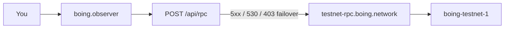

# 🔭 Boing Observer — Blockchain Explorer

Browse blocks, transactions, accounts, QA, and native DEX on **Boing Network**. Live at **[boing.observer](https://boing.observer)**.

**Boundary:** Boing Observer is a **Boing-native** explorer (Boing RPC + `@boing-network/boing-sdk`). It is **not** an Etherscan clone and does **not** embed an EVM runtime. EVM explorers/contracts live under **boing.finance**.

> 👋 **Everyday users:** paste a block height, block hash, or 64-character account into search. Testnet is the default. Get coins at [boing.network/faucet](https://boing.network/faucet).  
> 🛠️ **Developers:** Next.js 15 App Router. Browser traffic goes through same-origin `POST /api/rpc` (CORS-safe). Direct node calls happen only on the server.  
> 🛰️ **Operators:** `NEXT_PUBLIC_TESTNET_RPC` defaults to `https://testnet-rpc.boing.network/`. Upgrading a laptop node does **not** change production explorer RPC.



## ✨ What you can do

| Surface | URL | What it is |
|---------|-----|------------|
| 🏠 Home | `/` | Chain height, latest blocks, search |
| 🧱 Block | `/block/:height` or `/block/hash/:hash` | Header + transactions |
| 👤 Account | `/account/:address` | Balance, nonce, stake (32-byte hex) |
| 📄 Transaction | `/tx/:txId` | Receipt when the node has one |
| ✅ QA transparency | [`/qa`](https://boing.observer/qa) | Live pool + public Allow/Reject voting |
| 📜 QA gate rules | [`/qa/rules`](https://boing.observer/qa/rules) | Every Allow / Reject / Unsure rule + PDF |
| 🧪 QA check | `/tools/qa-check` | Pre-flight `boing_qaCheck` |
| 💱 DEX | `/dex/pools`, `/dex/quote` | Read-only directory + CP quotes via `@boing-network/boing-sdk` |
| 🖼️ Asset | `/asset/:address`, `/asset/:address/item/:tokenId`, `/tokens` | Metadata scan; reference NFT collection + **per-item** profiles (owner/metadata XOR slots). FreshMint-style hash token ids via mint calldata decode in recent blocks ([BOING-REFERENCE-NFT.md](https://github.com/Boing-Network/boing.network/blob/main/docs/BOING-REFERENCE-NFT.md) — v3 `mint_batch` n≤500 is one receipt). **Linked tokens & collections** (plain-language UI) resolve official NFT↔fungible links from the on-chain registry on asset, account, and NFT item pages (read-only; `links_count` / `get_link_at`, tombstones skipped) — see [BOING-LINKED-NFT-TOKEN.md](https://github.com/Boing-Network/boing.network/blob/main/docs/BOING-LINKED-NFT-TOKEN.md). **Builder attested** (planned read-only): optional builder signal from a separate on-chain registry when an active attestation exists for a companion pair — see [BOING-BUILDER-ATTESTATION.md](https://github.com/Boing-Network/boing.network/blob/main/docs/BOING-BUILDER-ATTESTATION.md) |
| 📡 RPC catalog | `/tools/rpc-catalog` | Live `boing_getRpcMethodCatalog` |
| ❤️ Node health | `/tools/node-health` | Height, sync, optional `boing_health` |
| 📖 About | [`/about`](https://boing.observer/about) | Six pillars PDF |

Network selector: **Testnet** by default. **Mainnet** only appears as live when `NEXT_PUBLIC_MAINNET_RPC` is set to a **distinct** URL — never the testnet URL.

## 🧰 Tech stack

- **Next.js 15** (App Router), React 18, TypeScript
- **Tailwind CSS** with Boing design tokens (Comfortaa, dark theme, aqua/teal)
- **RPC** — Browser: same-origin `POST /api/rpc`. Server routes: direct HTTP. DEX tooling uses **`@boing-network/boing-sdk@^0.5.38`** from npm
- **Cloudflare** — OpenNext adapter → Workers; custom domain **boing.observer**

## 🚀 Setup

```bash
npm ci --legacy-peer-deps   # or npm install --legacy-peer-deps
cp .env.example .env.local
npm run dev
```

Open [http://localhost:3000](http://localhost:3000).

```bash
npm run lint
npm run typecheck
npm test
npm run build
npm run test:e2e   # Playwright, mocked RPC; build first
```

(`--legacy-peer-deps` is required because the Cloudflare adapter’s peer range can lag the Next 15 line we actually run.)

## ⚙️ Config

| Variable | Description |
|----------|-------------|
| `NEXT_PUBLIC_TESTNET_RPC` | Testnet RPC (default `https://testnet-rpc.boing.network/`) |
| `NEXT_PUBLIC_TESTNET_RPC_FALLBACKS` | Extra testnet origins (comma-separated). The proxy already failsovers to hosted Fly nodes |
| `NEXT_PUBLIC_MAINNET_RPC` | Mainnet RPC. **Leave unset** until a distinct mainnet endpoint is published |
| `BOING_OPERATOR_RPC_TOKEN` | Server-only; must match validator `X-Boing-Operator`. Never `NEXT_PUBLIC_` |
| `BOING_QA_VOTE_RPC` | Validator JSON-RPC for `boing_qaPoolVote` (defaults to `https://boing-testnet-1.fly.dev`). Signed Express votes normally submit through the wallet RPC. |
| `BOING_BLOB_DOWNLOAD_TOKENS` | Comma-separated download permission tokens for `GET /api/blob/download` (also accepts the operator token). |
| `BOING_BLOB_DOWNLOAD_RPC` | Origin for raw `GET /v1/media/blob?id=…` (defaults to Fly `boing-testnet-1`, not the public gateway). |
| `NFT_OWNER_INDEXER_URL` | Origin of `workers/nft-owner-indexer` (no trailing slash; alias `BOING_NFT_OWNER_INDEXER_URL`). Enables **`GET /api/account/nfts?network=&id=`**. |
| `NEXT_PUBLIC_BOING_LINKED_NFT_TOKEN_REGISTRY` | Optional override for companions registry AccountId (public testnet default baked in) |
| `NEXT_PUBLIC_BOING_BUILDER_ATTESTATION_REGISTRY` | Optional override for builder attestation registry AccountId (public testnet `0x734077a9…1816`; for future read-only **Builder attested** UI) |

Server-side tuning (`TOKEN_INDEX_CACHE_DIR`, `TOKEN_INDEX_CACHE_TTL_SEC`, `TOKEN_METADATA_GATEWAY_URLS`, `BOING_OBSERVER_ALLOW_DEX_DIAGNOSTICS`, `BOING_NATIVE_VM_DEX_FACTORY`) and the Playwright live flags are documented in [docs/OPERATIONS.md](docs/OPERATIONS.md), which also lists every script.

No API keys for read-only RPC. Do not hardcode production RPC URLs.

### Rate limiting, CSP and security headers

`src/middleware.ts` rate-limits `/api/*` per client (in-memory per Worker isolate, plus an optional Workers Rate Limiting binding)
and sends a Report-Only Content-Security-Policy. Tune with `BOING_OBSERVER_RATE_LIMIT`, `BOING_OBSERVER_RATE_LIMIT_SCALE` and
`BOING_OBSERVER_CSP`; details and caveats in [docs/OPERATIONS.md](docs/OPERATIONS.md).

### RPC retries and “Method not found”

- Browser calls **`POST /api/rpc`**. Client retries **once** on network errors, HTTP 429, and 5xx. The proxy fails over to Fly origins on **403, 502-504, 521-526, 530** and Cloudflare challenge pages.
- The proxy only forwards an allow-list of methods (`src/lib/rpc-proxy-policy.ts`), rejects batches, requires `params` to be an array of at most 8 items, and caps request bodies at 1 MiB and responses at 6 MiB. Other methods get JSON-RPC `-32601`.
- Global security headers (nosniff, `X-Frame-Options: DENY`, HSTS, Permissions-Policy, baseline CSP) come from `security-headers.mjs`.
- There is **no** automatic failover on **`Method not found`**. `/qa` still shows **canonical QA JSON and doc links** when `boing_getQaRegistry` fails. See [THREE-CODEBASE-ALIGNMENT.md §2.1](https://github.com/Boing-Network/boing.network/blob/main/docs/THREE-CODEBASE-ALIGNMENT.md#21-qa-registry-rpc-boing_getqaregistry--two-different-surfaces).
- **`/dex/pools`** uses **`@boing-network/boing-sdk` against RPC** today. Optional Worker directory: [HANDOFF_NATIVE_DEX_DIRECTORY_R2_AND_CHAIN.md](https://github.com/Boing-Network/boing.network/blob/main/docs/HANDOFF_NATIVE_DEX_DIRECTORY_R2_AND_CHAIN.md).

## ☁️ Hosting on Cloudflare

```bash
npx wrangler login
npm run deploy
```

Attach **boing.observer** under Workers & Pages → **boing-observer** → Domains & Routes.

GitHub Actions deploys on `main` **after** CI (lint, typecheck, unit tests, production build, Playwright) succeeds. Secrets: `CLOUDFLARE_API_TOKEN`, `CLOUDFLARE_ACCOUNT_ID`. Variables: `NEXT_PUBLIC_TESTNET_RPC`, `NEXT_PUBLIC_MAINNET_RPC`.

| Command | Description |
|--------|-------------|
| `npm run dev` | Local Next.js |
| `npm run build` | Production Next build |
| `npm run lint` / `typecheck` / `test` | ESLint / `tsc --noEmit` / Vitest |
| `npm run test:e2e` | Playwright (run `build` first) |
| `npm run preview` | OpenNext in Workers runtime |
| `npm run deploy` | Build and deploy to Cloudflare |

## 📚 Reference

- Protocol docs: `Boing-Network/boing.network` on `main` under `docs/`
- Alignment: [THREE-CODEBASE-ALIGNMENT.md](https://github.com/Boing-Network/boing.network/blob/main/docs/THREE-CODEBASE-ALIGNMENT.md)
- Linked NFT↔token companions (on-chain registry, read-only on asset/account/NFT item pages): [BOING-LINKED-NFT-TOKEN.md](https://github.com/Boing-Network/boing.network/blob/main/docs/BOING-LINKED-NFT-TOKEN.md) — public testnet registry **v2** `0xf704485ad29f56bb6516ac822fcf9ca8fcb6c4266e22c9ed7f9c6908668655dd` (salt `BOING_NFT_TOKEN_LINK_REG_V2`, selectors `0xE0`-`0xE8`; explorer reads `links_count` / `get_link_at`; v1 `0xebf9f019...3dd8` is superseded)
- Builder attestation (on-chain builder signal; companions remain project authority): [BOING-BUILDER-ATTESTATION.md](https://github.com/Boing-Network/boing.network/blob/main/docs/BOING-BUILDER-ATTESTATION.md) — public testnet registry `0x734077a9f926077d39e84ec278b77b7b600c840f7101809646d8797a6a9e1816` (salt `BOING_BUILDER_ATTEST_REG_V1`, selectors `0xE0`–`0xE6`; read via `attestations_count` / `get_attestation_at`). Explorer UI for **Builder attested** is not shipped yet — document the AccountId here for implementers.
- Local handoff (current state, known gaps): [HANDOFF.md](HANDOFF.md)
- Operations (env, scripts, CI, indexing): [docs/OPERATIONS.md](docs/OPERATIONS.md); contract interface resolution: [docs/CONTRACT-FUNCTIONS.md](docs/CONTRACT-FUNCTIONS.md)

---

*Boing Network — Authentic. Decentralized. Optimal. Sustainable.*
